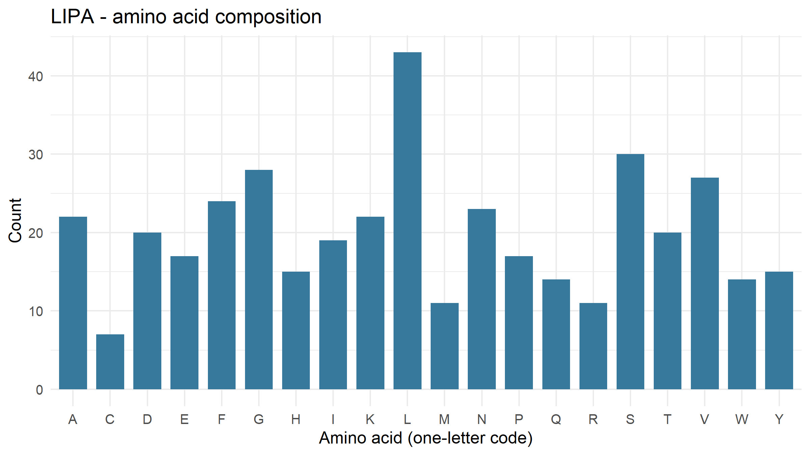
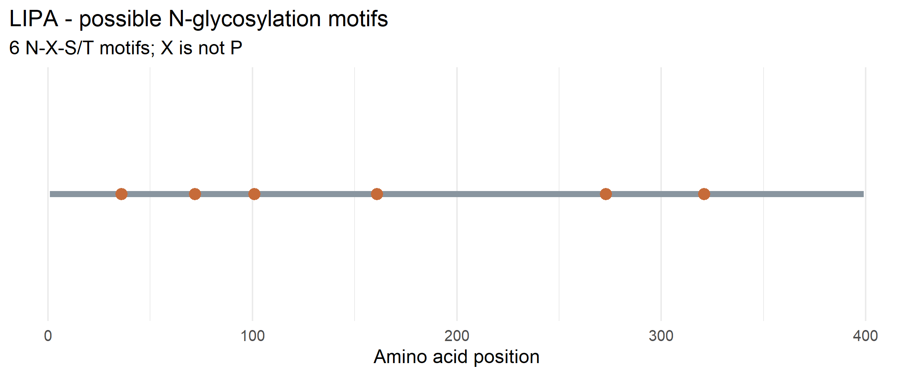

# Exploring Lysosomal Enzymes Using NCBI and R

**Name:** Kyla Rose D. Villegas  
**Section:** B  
**Course:** BIO 300 – Cell and Molecular Biology  

---

# Exploring Lysosomal Enzymes Using NCBI and R

## Project Overview

This individual laboratory activity explores the human lysosomal enzyme **lysosomal acid lipase (LAL)**, encoded by the **LIPA** gene.

- **Organism:** Homo sapiens
- **Gene:** LIPA
- **Enzyme:** Lysosomal acid lipase/cholesteryl ester hydrolase
- **RefSeq Protein Accession:** NP_000226.2
- **Protein Length:** 399 amino acids

Lysosomal acid lipase normally hydrolyzes **cholesteryl esters and triglycerides inside lysosomes**.

## NCBI Record

**NCBI RefSeq:** NP_000226.2

## Methods

The human LIPA protein sequence was obtained from NCBI using RefSeq accession **NP_000226.2**.

The sequence was analyzed using R to determine:

1. Protein length
2. Amino acid composition
3. Most common amino acids
4. Potential N-glycosylation motifs

A potential N-glycosylation motif was identified using the pattern **N-X-S/T**, where X can be any amino acid except proline (P).

The analysis was performed using the R packages `rentrez` and `ggplot2`.

## Results

### Protein Information

| Feature | Result |
|---|---|
| Gene | LIPA |
| Accession | NP_000226.2 |
| Protein length | 399 amino acids |
| Potential N-glycosylation motifs | 6 |

### Amino Acid Composition

The LIPA protein sequence contains **399 amino acids**.

The five most common amino acids are:

| Amino Acid | One-Letter Code | Count | Percent |
|---|---|---:|---:|
| Leucine | L | 43 | 10.78% |
| Serine | S | 30 | 7.52% |
| Glycine | G | 28 | 7.02% |
| Valine | V | 27 | 6.77% |
| Phenylalanine | F | 24 | 6.02% |

### Potential N-Glycosylation Motifs

The sequence analysis identified **six potential N-glycosylation motifs**.

| Position | Motif |
|---:|:---:|
| 36 | NVS |
| 72 | NHS |
| 101 | NSS |
| 161 | NKT |
| 273 | NMS |
| 321 | NQS |

## Answers to the Laboratory Questions

### 1. What does the enzyme normally break down inside lysosomes?

Lysosomal acid lipase normally breaks down **cholesteryl esters and triglycerides** inside lysosomes.

### 2. What is the total protein length and which amino acids are most common?

The LIPA protein sequence analyzed is **399 amino acids long**.

The most common amino acid is **leucine (L)** with 43 residues (10.78%). The other four most common amino acids are serine (S), glycine (G), valine (V), and phenylalanine (F).

### 3. How many potential N-glycosylation motifs were found and where are they located?

A total of **six potential N-glycosylation motifs** were identified.

They are located at positions:

- Position 36: NVS
- Position 72: NHS
- Position 101: NSS
- Position 161: NKT
- Position 273: NMS
- Position 321: NQS

### 4. Why does glycosylation matter for lysosomal proteins? Does a motif prove glycosylation?

Glycosylation can help lysosomal proteins with **proper folding, stability, and trafficking** through the cell. Glycosylation can also be involved in the targeting of lysosomal enzymes to lysosomes.

However, finding an **N-X-S/T motif does not prove that glycosylation actually occurs** at that site. The motif only indicates a potential site. Sequence analysis alone cannot experimentally confirm glycosylation or the presence of a mannose-6-phosphate tag.

### 5. What might happen in a cell if the enzyme failed?

If lysosomal acid lipase failed to function, **cholesteryl esters and triglycerides could accumulate inside lysosomes**. This accumulation can interfere with normal cellular function and is associated with lysosomal acid lipase deficiency.

## Project Files

### R Script

`lysosomal_enzyme_analysis.R`

### Data

`data/LIPA.fasta`

### Results

`results/LIPA_summary.csv`

`results/LIPA_amino_acid_counts.csv`

`results/LIPA_motif_positions.csv`

### Figures

`figures/LIPA_amino_acid_composition.png`

`figures/LIPA_potential_N_glycosylation.png`

## Limitations

This analysis is based on the protein sequence of LIPA. The identification of N-X-S/T motifs only indicates **potential N-glycosylation sites**. It does not experimentally determine whether the sites are glycosylated. The analysis also does not measure enzyme activity.

## Conclusion

The human LIPA protein sequence analyzed using NCBI and R is **399 amino acids long** and contains six potential N-glycosylation motifs. Leucine is the most abundant amino acid in the sequence, with 43 residues. The sequence analysis provides information about the protein's amino acid composition and potential glycosylation sites but does not experimentally confirm glycosylation or enzyme activity.
